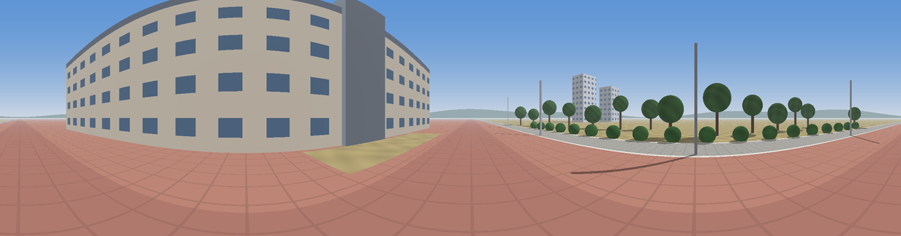
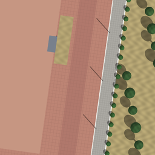
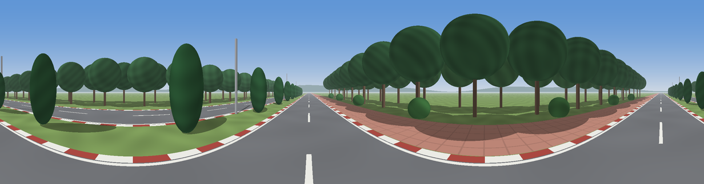
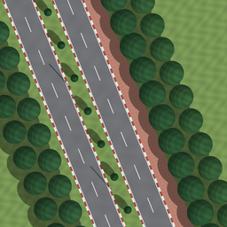
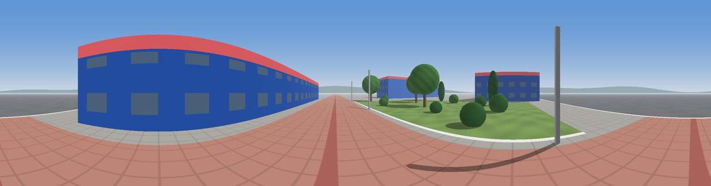
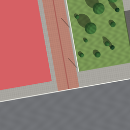
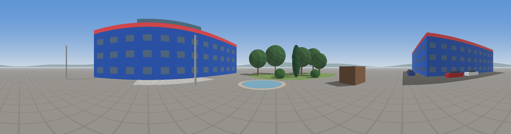
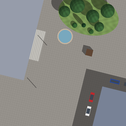

# Data scraping for Cross-View Geo-localization (Google Streetview)

A command line tool for collecting paired ground-level and aerial images over a bounded geographic
area, intended for cross-view geo-localization (CVGL) experiments.

Given a circle, a boundary polygon, or both, it enumerates the Google Street View panoramas inside
the area and produces one image pair per panorama:

Disclaimer: This tool is developed strictly for educational and academic research purposes. Users are responsible for complying with the Terms of Service of any third-party mapping platforms. The author does not host or distribute any copyrighted imagery.

| View   | Default size (px) | Content                                                              |
|--------|-------------------|----------------------------------------------------------------------|
| Ground | 1232 × 324        | 360° panorama strip, north at the image centre, ±47° around horizon  |
| Aerial | 256 × 256         | Satellite patch, north up, centred on the panorama position          |

## Examples

Illustrations of the output format, not collected imagery. Each pair is rendered from one synthetic
scene with the projection and alignment the tool uses: the ground view is a north-centred 360° strip
covering ±47° around the horizon, the aerial view a north-up patch of 57.5 m centred on the camera.

| Ground view (1232 × 324) | Aerial view (256 × 256) |
|--------------------------|-------------------------|
|  |  |
|  |  |
|  |  |
|  |  |

## Installation

Python 3.10 or newer is required.

```
git clone https://github.com/AyberkA0/cvgl-streetview-scrape
cd cvgl-streetview-scrape
pip install .
```

This installs the `cvgl-scrape` command. Without installing, `python -m cvgl_scrape` is equivalent.

## Usage

Collect everything within 500 m of a point:

```
cvgl-scrape run --center 41.2074 32.6564 --radius 0.5 --out data/example
```

Collect everything inside a polygon, using the supplied configuration for the campus of Karabük
University:

```
cvgl-scrape run --config configs/karabuk_university.yaml
```

Inspect a few pairs before committing to a full run:

```
cvgl-scrape run --config configs/karabuk_university.yaml --limit 10
```

`run` executes three stages, which are also available as separate commands:

| Command  | Action                                                                  |
|----------|-------------------------------------------------------------------------|
| `search` | Lists the panoramas inside the area in `metadata.csv` and draws the map |
| `ground` | Downloads the ground view of every listed panorama                      |
| `aerial` | Downloads the aerial view of every listed panorama                      |
| `status` | Reports how many views and complete pairs a dataset directory holds     |
| `export` | Compiles the complete pairs into a training-ready dataset               |

Images that already exist are skipped, so an interrupted download is resumed by running the same
command again. The exit status is non-zero if any request failed permanently.

### Options

| Option                | Default      | Description                                                 |
|-----------------------|--------------|-------------------------------------------------------------|
| `-o`, `--out`         | `dataset`    | Dataset directory                                           |
| `-c`, `--config`      |              | YAML file providing defaults for the options below          |
| `--center LAT LON`    |              | Centre of a circular area, in decimal degrees               |
| `--radius KM`         |              | Radius of the circular area                                 |
| `--boundary GEOJSON`  |              | Polygon or multipolygon; panoramas outside of it are dropped|
| `--areas FILE`        |              | YAML list of named areas, searched together                 |
| `--spacing M`         | `40`         | Distance between query points                               |
| `--thin M`            |              | Keep one panorama per M-metre cell, the latest capture      |
| `--target N`          |              | Keep N panoramas chosen at random                           |
| `--balance`           |              | Spread `--target` evenly over the areas                     |
| `--seed`              | `0`          | Seed of the random choices                                  |
| `--ground-size WxH`   | `1232x324`   | Size of the ground view                                     |
| `--aerial-size PX`    | `256`        | Edge length of the aerial view                              |
| `--zoom`              | `19`         | Web Mercator zoom level of the aerial view                  |
| `--limit N`           |              | Download only the first N panoramas                         |
| `--concurrency N`     | `16`         | Panoramas processed at the same time                        |

One of `--center` with `--radius`, `--boundary` or `--areas` is required; with a centre and a
boundary, the area is their intersection. An areas file lists entries of the form
`{name: ankara, center: [39.92, 32.85], radius: 3}`; the name is stored with every panorama. A configuration file uses the option names with underscores (`ground_size: 1232x324`);
options given on the command line take precedence.

## Output

```
<out>/
  metadata.csv     one row per panorama
  map.html         panorama positions on a map
  ground/          <panoid>.jpg
  aerial/          <panoid>.jpg
```

`metadata.csv` has the columns

| Column    | Description                                                                 |
|-----------|-----------------------------------------------------------------------------|
| `panoid`  | Street View panorama identifier, also the file name of both views           |
| `area`    | Name of the area, empty for a single unnamed area                           |
| `lat`     | Latitude in decimal degrees (WGS 84)                                        |
| `lon`     | Longitude in decimal degrees (WGS 84)                                       |
| `utm_x`   | UTM easting in metres                                                       |
| `utm_y`   | UTM northing in metres                                                      |
| `utm_zone`| UTM zone; all panoramas of an area share the zone of its mean longitude     |
| `heading` | Compass direction of the centre of the original panorama, in degrees        |
| `year`    | Capture year, empty if not reported                                         |
| `month`   | Capture month, empty if not reported                                        |

A panorama can be listed and still be unavailable for download; such rows have no ground view.
Every image carries the panorama position as EXIF GPS tags and the panorama identifier as its EXIF
image description.

### Training-ready datasets

```
cvgl-scrape export --out data/example --to EXAMPLE --pairs 1000
```

copies the complete pairs into a new directory and adds what a training script needs:

```
EXAMPLE/
  README.md        dataset card with the counts per split, area and year
  metadata.csv     one row per pair, with its split and the image paths
  metadata.json    panoIds, latlng, utm, utmZone, area, trainSet, valSet
  splits/          train.csv, val.csv
  ground/          <panoid>.jpg
  aerial/          <panoid>.jpg
```

`trainSet` and `valSet` are zero-based indices into the other arrays, which follow the row order of
`metadata.csv`. Because UTM coordinates are planar, the distance in metres between two pairs of the
same zone is the Euclidean distance of their `utm` entries.

Splits are spatial: the area is divided into cells of `--block` metres (default 500) and each cell
is assigned to one split as a whole, so that neighbouring panoramas are not separated. `--val`
(default 0.2) and `--test` (default 0) set the fractions.

## Method

**Panorama enumeration.** The bounding box of the area is covered with a regular grid of query
points. Each point is sent to the Street View panorama search, which returns the nearest panorama
within 50 m together with its neighbours along the road graph and the older captures taken at the
same position. Results are merged by panorama identifier and restricted to the area. Because one
query returns several dozen panoramas, a grid spacing of 30–50 m is sufficient for complete
coverage of the road network. Capture dates are reported only for the panorama nearest to a query
point and for its older captures.

**Ground view.** Panoramas are stored as 512 × 512 px tiles in an equirectangular layout. The tiles
of zoom level 3 (4096 × 2048 px, or 3328 × 1664 px for older cameras) are fetched and stitched. The
image is shifted horizontally by the reported heading so that north falls on the centre column,
cropped symmetrically around the horizon to the target aspect ratio, and resampled with a Lanczos
filter. A strip of *W* × *H* pixels spans 360° horizontally and 360° · *H* / *W* vertically, which
is 94.7° for the default size and removes most of the sky and of the capture vehicle. Camera pitch
and roll are not corrected.

**Aerial view.** The Web Mercator pixel coordinates of the panorama position are computed at a
fixed zoom level, the satellite tiles covering a window centred on that position are fetched, and
the window is cropped out. The ground sampling distance at zoom level *z* and latitude *φ* is

```
GSD = 2π · 6378137 · cos(φ) / (256 · 2^z)   [m/px]
```

which at zoom 19 gives 22.5 cm/px at 41.2° N, so that a 256 px patch covers 57.5 m. The zoom level
is fixed for the whole dataset; the GSD therefore varies with cos(φ) across latitudes.

## Limitations

- The search and tile endpoints are internal to Google Maps and undocumented. They have changed
  before and may change again without notice.
- Automated bulk retrieval may conflict with the Google Maps Platform Terms of Service. The imagery
  remains the property of Google and its providers; check the terms before redistributing anything
  collected with this tool.
- Positions are those reported by Street View and inherit its GPS error, typically a few metres,
  which translates into an offset of the panorama from the centre of the aerial patch.
- Older captures of the same position are kept as separate panoramas and are paired with nearly
  identical aerial patches. Splitting such a dataset at random leaks positions between the training
  and the test set.
- The aerial imagery has a single, unknown acquisition date and may not match the season or year of
  the ground view.
- Only official Street View captures are collected; user-contributed photospheres are excluded.

## Development

```
pip install -e ".[dev]"
pytest
```

## License

The code is released under the MIT License, see [LICENSE](LICENSE). The licence covers the code only,
not the imagery retrieved with it.

## Acknowledgements

The grid-based enumeration of panoramas follows the idea of
[Streetview-panorama-scraping](https://github.com/FluffyMaguro/Streetview-panorama-scraping) by
FluffyMaguro, with thanks. The campus boundary is taken from OpenStreetMap, © OpenStreetMap
contributors.
